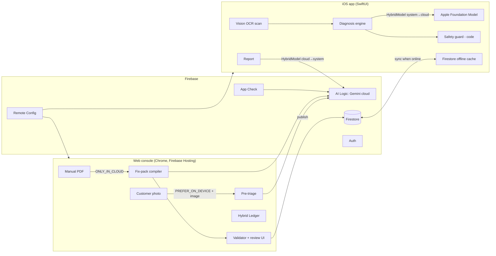

# Fieldnote — Master Plan

**Hackathon:** #BuildHybridAI 2026 (Google / Firebase, Devpost) — https://firebasehybridaihackathon.devpost.com/
**Deadline:** Mon Nov 30, 2026, 2:00 PM PT (5:00 PM ET). **Our submit target:** Mon Nov 30, 12:00 PM ET.
**Builder:** solo, near full-time. MacBook (M4, 16 GB), iPhone with Apple Intelligence, Xcode, free Apple developer account.
**Platforms entered:** iOS (primary) + Web/Chrome. Target prizes: **Best iOS**, plus a **Grand / runner-up** case through multi-platform.

---

## 1. Requirements we must meet (Stage One is pass/fail)

| # | Requirement (from the rules) | How we meet it | Phase |
|---|---|---|---|
| R1 | Gen AI app using Firebase AI Logic on ≥1 platform | iOS + Web, both hybrid | P1–P5 |
| R2 | Firebase AI Logic imported **and called at runtime** (not just in README) | Real calls on both platforms; README links to the exact call sites | P1, P8 |
| R3 | App Check (required by AI Logic; debug tokens accepted) | iOS debug provider, web reCAPTCHA Enterprise + debug token | P0–P1 |
| R4 | Public GitHub repo, all source, assets, run instructions | `fieldnote` repo, setup guide in README | P0, P8 |
| R5 | Open source license visible in the repo's About section (Apache preferred) | `LICENSE` = Apache-2.0, set in GitHub About | P0 |
| R6 | Text description: how AI Logic is used, features, value proposition | `docs/submission/DEVPOST_WRITEUP.md` | P8 |
| R7 | Demo video ≤3 min on public YouTube, English, shows app running on target platform(s) | iPhone (real device) + Chrome, captions on | P7–P8 |
| R8 | Working project for judging, free, until judging ends (Dec 16) | Hosted web console + demo login; iOS via video + build-from-source | P5, P8 |
| R9 | New project built during the submission period | New repo, no pre-existing code (state this in the write-up) | P8 |
| R10 | No production secrets / PII in repo, form, or testing instructions | `.example` configs, demo data only | All |
| R11 | App supports English; materials in English | Yes | All |

## 2. Extra points we are targeting (no formal bonus exists — these are the "encouraged" items)

| Item | Source in rules | Our plan |
|---|---|---|
| Multi-platform | "strong consideration for the Grand Prize" | iOS + Web, both with real hybrid features (not a web admin page only) |
| Supporting Firebase products | App Check, Remote Config, Firestore, Authentication "encouraged" | All four, each with a real job + Hosting |
| Hosted project URL | "strongly encouraged" | `https://<project>.web.app` with one-click demo login |
| Firebase Agent Skills with coding agents | "recommended", resources list Claude Code | Install in P0; credit in README with what they were used for |
| Google IDE (Antigravity) | "recommended but not required" | Optional: genuinely use Antigravity for the P6 web test pass. Only claim it if done. |
| AI-assisted judging may be used | rules: "automated AI-driven analysis" possible | README has a "Judging criteria map" section with links to code |
| Judges may judge from video/text only | rules | First 30 s of video shows the offline moment; captions burned in |
| Tiebreak order = Tech, Design, Impact, Idea | rules | Over-invest in tech depth: eval harness, routing table, tests |

## 3. Product

**One-liner:** *Fieldnote is a diagnostic copilot for HVAC technicians that works with zero bars: the cloud turns manuals into fix packs, and the phone's own AI walks the diagnosis.*

**Who:** licensed residential HVAC service technicians (especially newer ones) and the dispatcher/service manager at their shop.

**Problem (cite in write-up):** an estimated 110,000-technician shortage, 5 retiring for every 2 entering, newer techs calling senior techs for help; basements and mechanical rooms have poor signal; manuals are long PDFs. Competitor Bluon proves demand (nameplate scan + AI support) but is a cloud product. Our angle: offline-first, zero cost per question on-device, customer data stays on the phone, and the hybrid design guarantees the tech is never left with nothing.

**Three-tier promise (key design story):**
1. On-device AI (Apple Foundation Models / Gemini Nano): offline, instant, free.
2. Cloud AI (Gemini via Firebase AI Logic): when on-device isn't available or the task needs a bigger model.
3. Plain fix pack (no AI): the validated steps still render if both are unavailable. **The tech is never stuck.**

### Core user flows
**Dispatcher (Web, Chrome desktop)**
- W1 Upload a manual PDF → cloud compiles a fix pack → validator checks it → human review screen → publish (versioned).
- W2 Customer photo pre-triage: customer's photo of the furnace display/sticker → **on-device Gemini Nano with image input** reads brand, model, blinking code → likely fault + parts to bring.
- W3 Create/assign jobs (seeded demo jobs are fine).
- W4 Reports inbox: synced reports from the field.
- W5 Hybrid Ledger: every AI call logged as metadata (feature, source ON_DEVICE/IN_CLOUD, latency, est. cloud cost avoided). Charts.
- W6 Hybrid Status page: shows whether this browser has on-device AI, and how to enable it (flags, model download).

**Technician (iOS)**
- I1 Today's jobs (offline-cached) + fix packs pre-downloaded.
- I2 Scan: camera on nameplate → Vision OCR → regex extraction of brand/model/serial; ambiguous? on-device model disambiguates.
- I3 Error code: tech enters the LED flash count / code (or scans a display) → deterministic lookup in the pack.
- I4 Guided diagnosis: step cards. Tech enters readings/observations in plain words → on-device model interprets against the pack slice and picks the next step (structured output). Safety stops enforced in code.
- I5 Report: cloud-first customer report (plain-language summary, work done, parts, recommendations); offline it drafts a short version on-device and upgrades it when back online.
- I6 Badges everywhere: `On-device · 0.6 s · $0` / `Cloud · 1.8 s` / `Offline · queued 2`.

### Explicitly out of scope
Android, payments, push notifications, Sign in with Apple, real customer data, live video, voice (audio isn't supported on-device), manufacturer PDFs in the repo.

## 4. Hybrid routing table (the heart of "Technological Implementation")

| Feature | Platform | Mode | Why this placement |
|---|---|---|---|
| Compile manual PDF → fix pack | Web | `ONLY_IN_CLOUD` | PDF input is cloud-only; heavy, one-time per model |
| Validate fix pack | Web + iOS | Code (zod / Swift) | Determinism; reject bad model output |
| Read nameplate text | iOS | Apple Vision OCR (on-device, non-LLM) | Offline; on-device LLM has no image input on iOS |
| Disambiguate nameplate fields | iOS | Hybrid, on-device first | Offline, free; tiny prompt |
| Fault code lookup | iOS | Code | Facts come from the pack, never the model |
| Diagnosis step reasoning | iOS | Hybrid, on-device first (`HybridModel(primary: system, secondary: cloud)`) | Basements: offline, instant, $0 |
| Safety stops | iOS | Code | Never delegated to a model |
| Customer report | iOS | Hybrid, cloud first (`primary: cloud, secondary: system`) | Better long-form quality; still works offline |
| Photo pre-triage | Web | `PREFER_ON_DEVICE`, text + image | Photos of customers' homes stay in the browser; free |
| Job summary for dispatcher | Web | `PREFER_ON_DEVICE` | Free, fast, short |
| Ledger insights paragraph (optional) | Web | `PREFER_IN_CLOUD` | Aggregate metadata only |

Remote Config holds: `route_<feature>` (mode / primary order), `cloud_model_fast`, `cloud_model_compile`, `prompt_version_<name>`, `fixpack_min_version`, `ondevice_max_tokens`. Changing routing needs no app release (show this in the video: flip a flag, the badge changes).

## 5. Architecture



### Data model (Firestore)
```
orgs/{orgId}
  fixpacks/{packId}            # brand, modelPatterns[], version, status(draft|published), sourceRefs[], pack(JSON)
  jobs/{jobId}                 # customer (demo), address (demo), equipment?, status, assignedTo
    sessions/{sessionId}       # steps taken, readings, outcome, createdOffline:boolean
  reports/{reportId}           # jobId, text, generatedBy(ON_DEVICE|IN_CLOUD), upgradedAt?
  inferenceEvents/{eventId}    # feature, platform, source, latencyMs, promptTokensEst, ts (metadata only, no content)
users/{uid}                    # orgId, role(tech|dispatcher)
```
Rules: users read/write only within their org; techs can't publish packs; `inferenceEvents` write-only from clients.

### Fix pack format (`shared/fixpack.schema.json`)
```json
{
  "packId": "goodman-gmvc96-v1",
  "brand": "Goodman",
  "equipmentType": "gas_furnace",
  "modelPatterns": ["^GMVC96\\d{4}[A-Z]{2}$"],
  "version": 1,
  "sourceRefs": [{"title": "...installation manual", "url": "https://...", "pages": "62-64"}],
  "faultCodes": [
    {"code": "3", "display": "LED flashes 3 times", "meaning": "Pressure switch stuck open",
     "likelyCauses": ["blocked vent", "failed inducer", "kinked hose"], "firstStep": "S3-1"}
  ],
  "steps": {
    "S3-1": {"instruction": "Check the inducer motor runs on a call for heat.",
             "ask": {"type": "observation", "options": ["runs", "does not run", "runs noisy"]},
             "next": {"runs": "S3-2", "does not run": "S3-5", "runs noisy": "S3-6"},
             "safety": null}
  },
  "safetyStops": [{"id": "GAS", "triggers": ["smell gas", "gas odor", "rotten egg"],
                   "message": "Stop. Shut off gas supply, ventilate, follow your company's gas leak procedure."}]
}
```
The **model never invents steps**. It maps the tech's free-text observation to one of the step's `next` keys (structured output: `{choice, confidence, explanation, needsClarification?}`), and the code moves to that step. Free-text that matches a safety trigger stops the flow before any model call.

### Diagnosis engine protocol (same on both platforms)
Input to model (≤ ~1,500 tokens): system prompt + current step + allowed choices + tech's note + reading history (last 3).
Output (structured JSON): `{ "choice": "<one of allowed keys | unclear>", "confidence": 0-1, "say": "<≤2 sentences for the tech>" }`.
Code: validate `choice ∈ allowed`; if `unclear` or confidence < threshold (Remote Config), ask a clarifying tap-choice question. Log an inference event.
**Native on-device function calling (iOS)** is a stretch upgrade in P3 only if the P1 spike proves it works through Firebase hybrid (docs say "coming soon"). The structured-output loop above is the baseline and must work regardless.

## 6. Schedule (13 days)

| Day | Date | Phase | Gate |
|---|---|---|---|
| 1 | Wed Nov 18 | **P0** Setup, accounts, repo, agent skills · start **P1** spikes | — |
| 2 | Thu Nov 19 | **P1** Hybrid spikes on iOS + Chrome | **GO/NO-GO** end of day |
| 3 | Fri Nov 20 | **P2** Fix-pack schema, compiler, 3 packs | 👤 demo unit identified |
| 4–6 | Sat Nov 21 – Mon Nov 23 | **P3** iOS core: scan, engine, safety, diagnosis UI | Full diagnosis on device |
| 7 | Tue Nov 24 | **P4** Offline, sync, reports | Airplane-mode test passes · quota decision |
| 8–9 | Wed Nov 25 – Thu Nov 26 | **P5** Web console: pre-triage, ledger, status, hosting | Hosted URL live |
| 10 | Fri Nov 27 | **P6** Eval harness, hardening, tests | Eval table produced |
| 11 | Sat Nov 28 | **P7** Design polish + filming | Footage in the can |
| 12 | Sun Nov 29 | **P8** Video edit, README, write-up, Devpost draft | Draft saved on Devpost |
| 13 | Mon Nov 30 | **P9** Final QA, submit by 12:00 ET | Submitted |

**GO/NO-GO (end of Thu Nov 19):** GO if (a) iOS hybrid call returns from the on-device model (`modelVersion == apple-foundation-models-system-language-model`) on the real iPhone, (b) iOS structured output works on-device (or a reliable JSON-in-text fallback works), (c) Vision OCR reads a printed nameplate, (d) Chrome hybrid returns `inferenceSource == ON_DEVICE` for text + image. If (a) fails and can't be fixed by Fri noon → pivot to the backup idea (Off the Record, web-first); P0/P1 web work carries over.

**Quota account decision (Tue Nov 24):** Sprint 3 request closes Wed Nov 25, 10:00 AM PT. Request only if the free Gemini Developer API tier has blocked us (429s) during P2–P4. Default: don't.

## 7. Cut list (apply in this order if behind)
1. Ledger "insights" paragraph (W5 optional).
2. Job create/assign UI → seed jobs from a script.
3. Native on-device function calling (keep structured-output loop).
4. Third fix pack (keep 2 brands + the demo unit's brand).
5. Report "upgrade" from on-device draft to cloud version (keep cloud-first with on-device fallback).
**Never cut:** both platforms' hybrid features, safety guard, offline demo, eval table, inference badges, README criteria map.

## 8. Risk register

| Risk | Likelihood | Mitigation |
|---|---|---|
| iOS hybrid API differs from docs / bugs (experimental) | Med | P1 spike first; read SDK source; decision log |
| Simulator/macOS version mismatch blocks Foundation Models in Simulator | Med | Develop on the real iPhone; keep Simulator for UI only |
| Free signing expires in 7 days | Certain | Re-run from Xcode before filming (Sat) and before submission |
| Judges' Chrome lacks on-device model or multimodal flag | High | Cloud fallback works; Hybrid Status page explains; video shows on-device |
| Gemini free-tier rate limits | Low–Med | Cache compiled packs; compile once; quota decision Tue |
| Small-model accuracy | Med | Model only chooses among allowed keys; eval harness; clarifying questions |
| No real furnace to film | Med | Printed nameplate + LED mock (an Arduino LED blinking the code works great) |
| Copyright of manuals | Low | Store only facts (codes, steps paraphrased) + source URLs; no PDFs in repo |
| Safety/liability perception | Low | "For licensed technicians" onboarding; code-enforced stops shown in video |

## 9. Phase index
- `docs/phases/P0-setup.md`
- `docs/phases/P1-hybrid-spikes.md`
- `docs/phases/P2-fixpacks.md`
- `docs/phases/P3-ios-core.md`
- `docs/phases/P4-offline-sync-reports.md`
- `docs/phases/P5-web-console.md`
- `docs/phases/P6-eval-hardening.md`
- `docs/phases/P7-polish-filming.md`
- `docs/phases/P8-docs-video-devpost.md`
- `docs/phases/P9-final-qa-submit.md`
- Submission assets: `docs/submission/` (video script, write-up, testing instructions, checklist)

## 10. Decision log
| Date | Decision | Why |
|---|---|---|
| Nov 17 | Idea: Fieldnote over Off the Record | Better fit to fallback premise, small-model task fit, Best iOS path |
| Nov 17 | Platforms: iOS + Web; no Android | No supported Android device |
| Nov 17 | No paid Apple program | Video + hosted web + build-from-source satisfy testing rules |
| Nov 19 | iOS: build with the iOS 27 SDK (Xcode 27.2), deployment target iOS 26; Simulator = iPhone 17 on iOS 27.2 | Matches installed toolchain; device runs iOS 27.2.1 |
| Nov 19 | Firebase SDKs: JS `firebase` 13.4.0, `firebase-ios-sdk` 13.2.0 (plan said ≥12.5 / ≥12.13) | Latest stable; hybrid docs require ≥12.5 web, ≥12.13 iOS (SPM only) |
| Nov 19 | Cloud models: `cloud_model_fast` = **gemini-3.8-flash**, `cloud_model_compile` = **gemini-4-hydrogen** | Verified on firebase.google.com/docs/ai-logic/models (2026-11-19): both stable and "billing not required" on the Gemini Developer API. Hydrogen takes 900-page PDFs, 32K output (non-streaming). Gemini 2.5 models are shut down / auto-rerouted from Dec 1, so not used. If free-tier 429s hit, switch `cloud_model_fast` to gemini-3.5-flash-lite via Remote Config. |
| Nov 19 | Remote Config route values = the SDK's `InferenceMode` strings (`prefer_on_device`, `only_on_device`, `prefer_in_cloud`, `only_in_cloud`) | Web passes them straight through; iOS maps prefer_on_device → `HybridModel(primary: system, secondary: cloud)`, prefer_in_cloud → the reverse. Keys: `route_compile/triage/job_summary/ledger_insights/nameplate/diagnosis/report` |
| Nov 19 | Web App Check: `ReCaptchaEnterpriseProvider(VITE_RECAPTCHA_SITE_KEY)`; debug token only on localhost in dev | Token lives in `web/.env.development.local`, which `vite build` never loads; `npm run build` also scans `dist/` and fails on any debug token (verified with a negative test) |
| Nov 19 | iOS App Check: `AppCheckDebugProviderFactory` in DEBUG; `AppAttestProvider` factory in Release (App Attest registered in console; entitlement deferred, Release isn't distributed) | Docs: set the factory before `FirebaseApp.configure()` |
| Nov 19 | iOS debug tokens: gitignored `ios/Config/Secrets.xcconfig` → Info.plist (Debug only) → `setenv("AppCheckDebugToken")` before configure; simulator token on Simulator, device token on iPhone. Chosen over a user-scheme env var. | Works when the app is launched from the Home Screen (needed for the airplane-mode demo), picks sim vs device automatically, survives `xcodegen generate`. Env var name and precedence verified in AppCheckCore source (13.2.0): `AppCheckDebugToken` > `FIRAAppCheckDebugToken` > CLI config store (Simulator) > generated. |
| Nov 19 | No Cloud Storage (Spark plan). Manual PDFs are read client-side and sent inline | Inline request limit 20 MB; enough for service manuals |
| Nov 19 | iOS project via XcodeGen (`ios/project.yml`); generated `.xcodeproj` + `Package.resolved` are committed | Reproducible, and the project still opens without XcodeGen. Swift 6 language mode with MainActor default isolation; Swift Testing for unit tests |
| Nov 19 | Web toolchain: Vite 8, React 19, TypeScript 7, Vitest 4, zod 4, react-router 7, Playwright on the system Chrome channel | Latest stable; Chrome channel = no browser download and it's the browser with Gemini Nano. Firebase init lives in `web/src/firebase/client.ts` (P1 adds `web/src/ai/*`) |
| Nov 19 | Firebase agent skills installed at **project scope** (`.claude/settings.json`, plugin `firebase@firebase` v1.1.0, includes Firebase MCP server) | Reproducible for anyone opening the repo; usage logged in `docs/agent-skills.md` |
| Nov 19 | P1 note: initialize `FirebaseAI` with limited-use App Check tokens (`useLimitedUseAppCheckTokens: true` on iOS, equivalent on web) | Firebase AI Logic skill: replay-protected models return 403 without them |
| Nov 20 | **iOS: pin firebase-ios-sdk to 12.19.3** (supersedes the Nov 19 "13.2.0" entry). Web stays on JS 13.4.0. | 13.0.0 (Oct 6) removed `HybridModel` / `SystemLanguageModel` / `GenerativeModelSession`; 13.x routes Gemini through Apple's `LanguageModelSession` instead (iOS 27+), so on-device calls no longer go through Firebase. Rules require iOS "local execution via Firebase AI Logic", and the hackathon's iOS resource page is the `HybridModel` guide. 12.19.x keeps that API, supports `@Generable` structured output + FoundationModels tools in the hybrid session, and keeps the iOS 26 deployment target. Write-up should mention this. |
| Nov 20 | iOS structured output: native `@Generable` through the hybrid session is the primary path; JSON-in-text parse/validate kept as fallback | P1: 10/10 on-device online, 5/5 offline; fallback 3/3. The model's choice is always validated in code against the step's allowed keys (the schema-based `respond(schema:)` is internal in 12.19.3, so per-step enums can't be enforced by the schema) |
| Nov 20 | Native on-device function calling **works** (FoundationModels `Tool` via `generativeModelSession(tools:)`) | P1: 0.6–0.8 s on the iPhone. P3 may use it (e.g., fault-code lookup); cut-list item 3 is now low-risk |
| Nov 20 | Shared prompts and `remoteconfig.template.json` are bundled into the iOS app as XcodeGen resources (folder reference), not via a copy script | Same files on both platforms, no extra build phase; both apps derive Remote Config defaults from the deployed template |
| Nov 20 | Web `/spike` page and iOS "Hybrid spikes" screen are debug-only (dropped from production builds) | They make real AI calls; production bundles shouldn't expose them |
| Nov 20 | Seeded demo data: `users/{uid}` (orgId `demo`, role `tech`) for the Simulator's anonymous user, written as admin via the Firebase MCP server | Rules don't let clients create profiles; P5 adds a proper seed script for demo accounts |
| Nov 20 | **GO** at the P1 gate (~1 day late). Pivot rule not triggered | All six GO criteria pass on real hardware; the iPhone's initial `modelNotReady` was an OS model-download state, not an SDK failure |
| Nov 20 | Brands: Goodman *MVC96 (IOG-2015E), Carrier 59SC5B (59SC5B-05SI), Rheem R96V (92-24161-124-08); official manuals from the manufacturers' domains, kept local (gitignored) | User approved the default brands and the downloads |
| Nov 20 | Demo unit: none → Plan B (Goodman pack + printed nameplate + display mock) | User has no furnace to film. Goodman *MVC96 uses a 7-segment display ("EE2"); a blinking-LED shot would use the Carrier pack (code 31) |
| Nov 20 | Fix pack schema v1: decision steps (`ask` + `next`) or leaves (`outcome`), per-step `safety` stop ids, six universal safety stops (`shared/safety-stops.json`) required in every pack; pack stored in Firestore as its exact JSON text (`packJson`) | iOS validates byte-for-byte what the web validated; one schema (zod → generated JSON Schema) + Swift mirror, same error codes, 16 shared fixtures |
| Nov 20 | Compiler: index call + one structured-output call per fault code on a **page slice** of the manual (pdf-lib in the browser, inline data); validator-driven retry with feedback; 429/5xx backoff | Keeps each call small and checkable; no Cloud Storage; the 36 MB Rheem manual exceeds the 20 MB inline limit |
| Nov 20 | Admin scripts (seed, export) use Application Default Credentials (`gcloud auth application-default login`); demo accounts on `demo.fieldnote.test`, passwords generated into `.local-secrets`; dev-only demo sign-in buttons | No service-account key on disk; passwords never printed or bundled (dist scan checks them) |
| Nov 20 | Rules tests live in `rules-tests/` (firebase 12 + `@firebase/rules-unit-testing`); seed script is `web/scripts/seed.ts` (plan said `scripts/seed.ts`) | The rules-testing library still peers on firebase 12; the seed reuses the web validator |
| Nov 21 | `cloud_model_compile`: gemini-4-hydrogen → gemini-3.8-flash → **gemini-3.5-flash-lite** (Remote Config, no release) | Hydrogen: excellent trees but 60–120 s/call, frequent 500/503, then free-tier quota (429). 3.8-flash: 503 "Deadline expired" on every call. Flash-Lite: healthy, ~4 s/call; quality reviewed and acceptable. Revisit when the others recover |
| Nov 21 | Canonical pack JSON is tab-indented; packs carry the 7–8 most common gas-heat faults per brand | Whitespace from 2-space indentation of deep step trees was eating the 25 KB budget; packs now 18.9–21.9 KB |
| Nov 21 | Content review (v2): no bare yes/no questions; options name what the tech observes | The meaning of "yes" flipped between steps; descriptive options are clearer for the tech and the on-device model |
| Nov 21 | UI/UX: build a console design system at the **start of P5** (all console pages, incl. a redesigned /packs) and do the final polish in P7 | The console must look like a product dispatchers would buy (user); redesigning /packs now would be redone when P5 adds the dashboard, triage, ledger, and status pages |
| Nov 21 | P3 names: the plan's `interpret_observation.md` / `rc.min_confidence` are `shared/prompts/diagnosis.md` / `diagnosis_confidence_threshold` (set up in P1) | Kept the P1 names; same behavior |
| Nov 21 | Diagnosis prompt v1 → v3 (hedging rule, then negation + copy-the-option rules); confidence threshold 0.6 → 0.7 (Remote Config) | 10-note eval: a hedged note advanced on-device at exactly 0.60; clear notes score 0.8–1.0 |
| Nov 21 | Hedge words ("might", "not sure", …) always trigger a tap confirmation, in code (`HedgeDetector`), regardless of model confidence | Prompt-only hedging regressed with v3 ("vent might be ok" advanced). A guess must not move the diagnosis forward: code, not prompt |
| Nov 21 | Decision validator accepts a shortened answer only when all its words belong to exactly one option (iOS + web, same test table) | On-device model answered "loose" for "loose or defective"; exact match dropped it and stalled the iPhone run |
| Nov 21 | Undo (toolbar, AI turn, conclusion) and the conclusion shows how the last note was read | One iPhone misread of a negation ("no coating" → "oxidized") ended a diagnosis early; models can misread, so it must be one tap to recover |
| Nov 21 | Step cautions use "watch for" copy; the pack's stop message appears only on the full-screen stop. Stop confirmation is a full-width checkbox row, not a Toggle | "Stop… shut off power" on a live flame-current check contradicted the step; gloves need a big target |
| Nov 21 | Eval scenarios live in `eval/scenarios/` and are bundled into Debug builds; runner via launch args or the Diagnostics sheet; P6 grows the same format | Real on-device numbers need the iPhone; one tap there beats a cable and Xcode |
| Nov 22 | Report prompt is `shared/prompts/report.md` (plan said `customer_report.md`), route `route_report` = `prefer_in_cloud` (the plan's "cloudFirst") | Matches the P1 Remote Config keys (`route_report`, `prompt_version_report`) |
| Nov 22 | Reports are written from PII-free facts only (equipment, fault, checks, pack outcome, repair done, safety stops); the app prints the customer header itself | Customer details and free-text notes never reach a model; a test checks the prompt and stored facts |
| Nov 22 | Offline report = on-device draft; with no model at all, a plain report assembled from the pack. Back online, drafts are rewritten in the cloud automatically (`auto_upgrade_reports`, Remote Config) with retries; every version is kept with its model | The tech always leaves with a report; the dispatcher sees who wrote each version |
| Nov 22 | Reports only describe a repair as done when the tech ticks "I completed this repair" | The cloud model wrote "removed the blockages" from a pack recommendation; customer documents must not claim unconfirmed work |
| Nov 22 | Firestore rules: only the assigned tech writes a job's progress, sessions and reports; sessions and reports are validated field by field | Previously any org member could update any job's status |
| Nov 22 | Debug "Simulate offline" switch (pauses Firestore, pins diagnosis on-device, persists across launches) | The Simulator shares the Mac's network; this makes kill-while-offline testable without a device |
| Nov 22 | **Quota: skip the Sprint 3 request** | 3.5 Flash-Lite never returned 429 and meets quality/latency; 3.8 Flash and Gemini 4 Hydrogen fail on capacity (timeouts/503), which quota doesn't fix; hybrid design degrades to on-device/plain. Revisit only on Flash-Lite 429s before Nov 25 10 AM PT |

## 11. Progress log
_(Claude Code appends: date, phase, what's done, test status, open issues.)_

**Nov 19–20 · P0 Setup: complete (awaiting approval to start P1)**
- Done: secrets gitignored + `.example` twins + `scripts/setup-local-secrets.mjs`; web console scaffold (Vite/React/TS) with Firebase + App Check (reCAPTCHA Enterprise, localhost debug token); iOS app via XcodeGen with firebase-ios-sdk 13.2.0 and App Check debug provider; Firestore rules/indexes and Remote Config deployed; Firebase agent skills installed at project scope; README extended.
- Tests: web 13/13 (Vitest), build + dist secret scan OK, Playwright smoke OK; iOS 7 tests (9 cases) OK on the Simulator.
- Verified live: App Check tokens on Chrome localhost, iOS Simulator, and the real iPhone.
- Open: GitHub topics; App Attest entitlement (deferred); rules emulator tests (P2); 7-day free-signing renewal before filming/submission.
- P1 heads-up: use limited-use App Check tokens for AI Logic; the iOS `HybridModel` / `SystemLanguageModel` API is in the hybrid get-started doc (verified 2026-11-19).

**Nov 20 · P1 Hybrid spikes: GO (awaiting approval to start P2)**
- Done: shared prompts (`nameplate`, `diagnosis`, `triage`, `job_summary`) + synthetic sample images; web AI layer (`makeModel` from Remote Config routes, structured output on both paths, `inferenceSource` + latency) and dev-only `/spike` page; iOS `AIService` on firebase-ios-sdk 12.19.3 (`HybridModel`, `@Generable`, FoundationModels tools), Vision OCR, Remote Config defaults from the bundled template, headless spike runner (`-FNRunSpikes`), Firestore offline spike.
- Results: Chrome 8/8 ON_DEVICE (text, text+image, structured); iPhone 8/8 online (structured 10/10 at 1.56 s, tools 0.7 s) and 6/6 in airplane mode, all on-device; Vision OCR 0.07–0.25 s; cloud path with App Check on both platforms; offline Firestore write survived a kill and synced. Details in `docs/phases/P1-hybrid-spikes.md`.
- Tests: web 43/43 (incl. `makeModel` mode mapping with mocked `firebase/ai`), build + dist secret scan OK; iOS 27/27 (incl. JSON parse/validate fallback, real Vision OCR on the sample nameplate).
- Open: cloud latency on the iPhone (21.6 s vs 4–5 s Simulator); real-device airplane-mode Firestore pass (P4); schedule ~1 day behind (P2 was due today).

**Nov 20–21 · P2 Fix packs: complete (awaiting approval to start P3)**
- Done: fix pack schema v1 (zod + generated JSON Schema + Swift mirror) and validators with identical error codes on web and iOS; 16 shared fixtures; universal safety stops; compiler (page slice → index → per-code trees → assemble → validate, retry with feedback, 429/5xx backoff); `/packs` console (dispatcher sign-in, compile, review with step trees and issues, JSON edit, publish as next version, ledger row per call); seed (demo org, dispatcher + tech, 5 fictional jobs, packs) and export scripts (ADC); Firestore rules for publishing + 13 emulator tests; `scripts/ai-health.mjs`.
- Content: Goodman (8 codes, 21.9 KB), Carrier (8, 18.9 KB), Rheem (7, 19.2 KB), published v2 after a review pass; bundled in the iOS app.
- Tests: web 77/77, iOS 32/32, rules 13/13; build + dist secret scan OK.
- Open: Gemini 4 Hydrogen / 3.8 Flash were degraded on Nov 21 (compile now on 3.5 Flash-Lite; `cloud_model_fast` is still 3.8 Flash, so check `node scripts/ai-health.mjs` before P3/P4 cloud work); console UI polish scheduled for P5 (design system) and P7; schedule ~1.5 days behind (P3 was due to start today).

**Nov 21 · P3 iOS core: complete (awaiting approval to start P4)**
- Done: diagnosis engine (code safety guard before any model call, on-device-first interpretation, code validation, clarification, readings branch in code, Undo, plain-mode fallback); nameplate extraction + fault-code lookup; services (auth session, pack store re-validating Firestore packs, assigned-jobs listener, inference ledger); technician app (Today grouped by day, job, scan, fault code, diagnose, full-screen safety stop, conclusion, hidden Diagnostics with route override and eval runner); dark field theme, 56-pt targets, inference badges, dark launch screen.
- Results: iPhone in airplane mode ran Goodman EE0, Rheem 11, Carrier 13 to conclusions, all notes on-device (ledger: 24 turns, median 1.1 s, 0 failures; 2 safety stops with no model call). iPhone eval: 9/10 + 12/12 on-device at 0.69–0.74 s; cloud 10/10 + 12/12. Details in `docs/phases/P3-ios-core.md` and `eval/results/p3-notes.md`.
- Tests: iOS 67/67, web 86/86.
- Open: prewarm the on-device session at diagnosis start (first call up to 15 s); re-seed jobs before filming; scan → code not yet run on the iPhone in airplane mode (P4 airplane test covers it). Schedule: back on track (P3 done on its first day).

**Nov 22 · P4 Offline, sync, reports: complete (awaiting approval to start P5)**
- Done: diagnosis sessions saved after every step (queued offline) and resumable after a kill; customer report (cloud first online, on-device draft offline, plain fallback) with automatic cloud upgrade on reconnect (retries), every version credited to its model; "I completed this repair" fact; sync status pill (queued / syncing / synced, including writes queued before a relaunch); pull to refresh; packs-on-this-iPhone sheet; Remote Config `cached` origin; tighter Firestore rules for jobs, sessions, reports; seed `--reset`.
- Results: iPhone airplane-mode script passed (3 runs; the one manual tap led to the retry fix). Reconnect → cloud report 2–3 s automatic; on-device drafts 3.3–8.2 s offline; no data lost across two kills. Details in `docs/phases/P4-offline-sync-reports.md`.
- Tests: iOS 88/88, web 86/86, rules 19/19.
- Open: prewarm the on-device model (P7); `seed --reset` before filming; quota: skipped (see Decision log). Schedule: ~2 days ahead (P4 was due Tue Nov 24).
