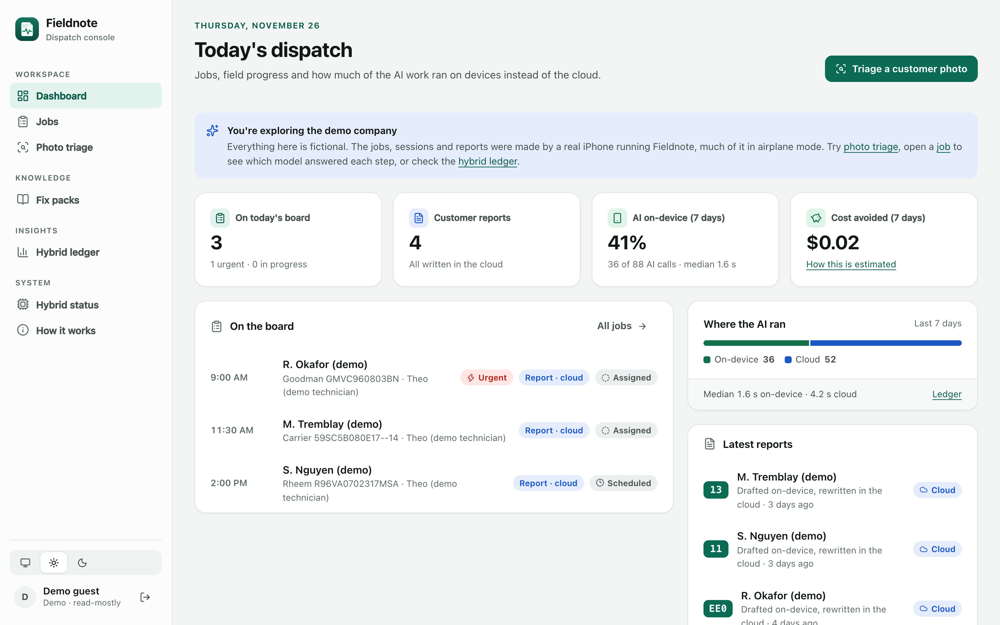
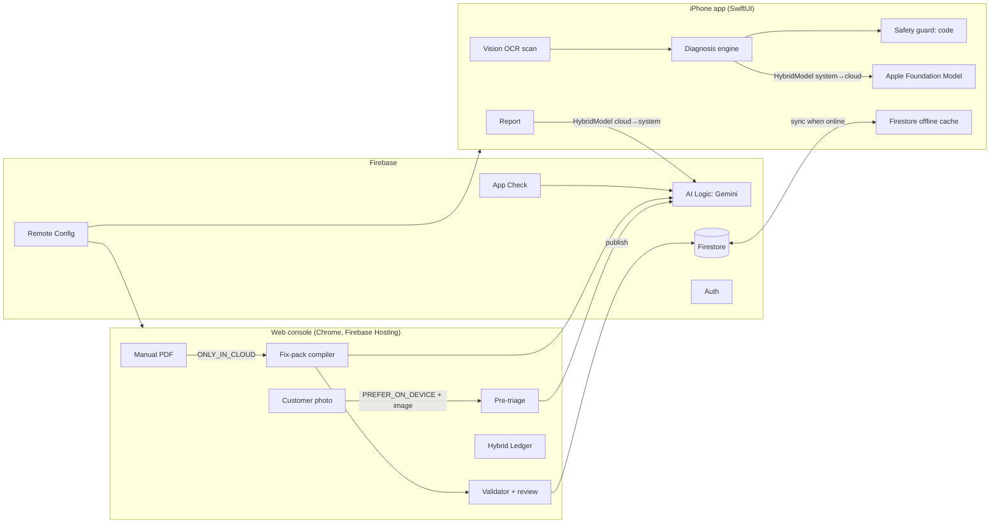

# Fieldnote

[](https://github.com/anshsahny/Fieldnote/actions/workflows/ci.yml)
[](LICENSE)

**HVAC diagnosis with zero bars.** The cloud turns manufacturer manuals into fix packs; the phone's own
AI walks the technician through the fix, in a basement with no signal. Built on **Firebase AI Logic
hybrid inference** for **iOS** (Apple Foundation Model) and **Web** (Chrome's Gemini Nano).

**Live console:** https://fieldnote-c28dc.web.app (click **Try the demo**, no account needed) ·
**Demo video:** _link added at submission_ · **Testing:** [`docs/submission/TESTING_INSTRUCTIONS.md`](docs/submission/TESTING_INSTRUCTIONS.md)

| Dispatcher console (web) | Technician app (iPhone) |
|---|---|
|  | Diagnosis runs on the iPhone's Apple Foundation Model through Firebase AI Logic. Notes are read on-device, safety stops are enforced in code, and the job syncs when signal returns. iPhone screenshots: [`docs/submission/screenshots`](docs/submission/screenshots). |

## The problem

Furnaces live in basements and mechanical rooms, where phones lose signal. Service manuals are long
PDFs. Demand for technicians keeps growing: the U.S. Bureau of Labor Statistics projects about
40,600 HVAC technician openings a year and 11% growth from 2025 to 2035, "much faster than average"
([BLS](https://www.bls.gov/ooh/installation-maintenance-and-repair/heating-air-conditioning-and-refrigeration-mechanics-and-installers.htm)).
That means many newer technicians alone in front of an unfamiliar unit. Cloud-only assistants stop
working exactly where the furnace is.

## What Fieldnote does

**Technician, iPhone (offline-first).** Scan the nameplate (Apple Vision OCR) to pick the fix pack,
enter the fault code, and follow the steps. Type what you see in plain words ("switch clicks
normally, drain tubes are clear"). The **on-device Apple Foundation Model, through Firebase AI Logic**,
maps the note to one of the step's answers in about 0.7 s, for $0, with no signal. Gas, CO and
electrical hazards stop the flow **in code, before any model call**. Back online, the session syncs
and the cloud writes the customer report, which the technician can send from the phone.

**Dispatcher, Chrome.** Upload a manufacturer manual. **Gemini in the cloud** compiles it into a
validated fix pack, which a person reviews and publishes to every technician's phone. Before
dispatch, **Chrome's on-device Gemini Nano with image input** reads the customer's photo of the
furnace display, so the right parts go on the truck and the photo of someone's home stays in the
browser. The **Hybrid Ledger** shows where every AI call ran, how fast, and what it would have cost.

## Why hybrid: three tiers, never a dead end

1. **On-device first** (Apple Foundation Model, Gemini Nano): works offline, answers in under a
   second on the iPhone, costs nothing, and the data stays on the device.
2. **Cloud when it helps** (Gemini 3.5 Flash-Lite): PDFs, long-form reports, and any device that
   can't run a model.
3. **Plain fix pack** (no AI): the validated steps still render with tap answers. The technician is
   never stuck.

The model never invents steps. It only picks among the current step's allowed answers, code
validates the pick, and a low-confidence or hedged note ("vent might be ok") becomes a one-tap
question instead of a guess.

## Hybrid routing (where each feature runs, and the code that calls Firebase AI Logic)

Routes live in Remote Config (`route_*` in [`remoteconfig.template.json`](remoteconfig.template.json)),
so they change without an app release.

| Feature | Platform | Runs on | Why | Call site |
|---|---|---|---|---|
| Diagnosis notes | iOS | On-device first (`HybridModel(primary: system, secondary: cloud)`) | Basements: offline, ~0.7 s, $0 | [`AIService.swift#L37-L55`](ios/Fieldnote/AI/AIService.swift#L37-L55), [`HybridInterpreter.swift#L11-L24`](ios/Fieldnote/Services/HybridInterpreter.swift#L11-L24) |
| Nameplate disambiguation | iOS | On-device first | Tiny prompt; serial numbers never sent | [`HybridInterpreter.swift`](ios/Fieldnote/Services/HybridInterpreter.swift) (`NameplateDisambiguator`) |
| Customer report | iOS | Cloud first, on-device draft offline | Better long-form in the cloud; still works offline | [`ReportService.swift#L17-L28`](ios/Fieldnote/Services/ReportService.swift#L17-L28) |
| Photo pre-triage (text + image) | Web | `PREFER_ON_DEVICE` (Gemini Nano) | Customers' home photos stay in the browser | [`hybrid.ts#L26-L61`](web/src/ai/hybrid.ts#L26-L61), [`TriagePage.tsx#L143-L151`](web/src/pages/triage/TriagePage.tsx#L143-L151) |
| Manual PDF → fix pack | Web | `ONLY_IN_CLOUD` | PDF input is cloud-only; done once per model | [`compileModel.ts`](web/src/ai/compileModel.ts) |
| Fix pack validation | Web + iOS | Code (zod / Swift, same error codes) | Bad model output is rejected | [`validate.ts`](web/src/fixpack/validate.ts), [`FixPackValidator.swift`](ios/Fieldnote/FixPack/FixPackValidator.swift) |
| Nameplate text, fault-code lookup | iOS | Apple Vision OCR, code | Facts come from the pack, never the model | [`NameplateExtractor.swift`](ios/Fieldnote/Core/NameplateExtractor.swift), [`FaultCodeLookup.swift`](ios/Fieldnote/Core/FaultCodeLookup.swift) |
| Safety stops | iOS (+ shared tests) | Code | Never delegated to a model | [`SafetyGuard.swift`](ios/Fieldnote/Core/SafetyGuard.swift), [`shared/safety-stops.json`](shared/safety-stops.json) |

Firebase AI Logic is initialized with App Check limited-use tokens on both platforms:
[`AIService.swift#L31-L34`](ios/Fieldnote/AI/AIService.swift#L31-L34), [`firebase.ts`](web/src/ai/firebase.ts).
iOS uses firebase-ios-sdk **12.19.3** on purpose: it is the last release with the `HybridModel` /
`SystemLanguageModel` API (13.0 removed it).

## Eval: on-device vs cloud

24 diagnosis scenarios (8 per brand, 64 technician notes: clean, messy, hedged, safety and
trade-knowledge) run through each platform's own rules with the route forced. The same notes,
prompt and code checks run on every route. Full report, every miss, and what was tuned:
[`eval/results/README.md`](eval/results/README.md).

| Route | Right answer on clear notes | Wrong answer accepted | Asked instead of answering | Model errors | Asked on hedged notes | Safety stops | Scenarios fully right | Median latency | Cloud cost (all turns) |
| --- | --- | --- | --- | --- | --- | --- | --- | --- | --- |
| iPhone · On-device | 54/56 (96%) | **0** | 1 | 1 | 4/4 (100%) | 4/4, 0 model calls | 22/24 | 0.65 s | $0 |
| iPhone · Cloud | 56/56 (100%) | **0** | 0 | 0 | 4/4 (100%) | 4/4, 0 model calls | 24/24 | 0.93 s | $0.02 |
| iOS Simulator · On-device | 55/56 (98%) | **0** | 1 | 0 | 4/4 (100%) | 4/4, 0 model calls | 23/24 | 1.97 s | $0 |
| iOS Simulator · Cloud | 56/56 (100%) | **0** | 0 | 0 | 4/4 (100%) | 4/4, 0 model calls | 24/24 | 2.48 s | $0.02 |
| Chrome · On-device | 56/56 (100%) | **0** | 0 | 0 | 4/4 (100%) | 4/4, 0 model calls | 24/24 | 3.42 s | $0 |
| Chrome · Cloud | 56/56 (100%) | **0** | 0 | 0 | 4/4 (100%) | 4/4, 0 model calls | 24/24 | 1.17 s | $0.02 |

**Wrong answer accepted** is the miss that matters, and it is zero on every route. The iPhone's two
on-device misses are safe: one note asked the technician instead of answering, and one hit Apple's
on-device safety filter on the word "termination" (as in vent termination). The app now retries that
once on the device and then asks the cloud when online ([`HybridInterpreter.swift`](ios/Fieldnote/Services/HybridInterpreter.swift)).
Chrome's on-device run went from 54/56 with one wrong answer to 56/56 after a fact was added to the
fix packs (a gas valve is on when its handle is in line with the pipe), not by tuning the prompt to
the test.

## Judging criteria map

**Technological implementation**
- Real hybrid inference on both platforms, with the SDK-reported source on every call
  ([iOS](ios/Fieldnote/AI/AIService.swift), [web](web/src/ai/hybrid.ts)); routes, models, prompt
  versions and the confidence threshold come from Remote Config.
- Structured output (`@Generable` on iOS, JSON schema / `responseConstraint` on web), validated in code
  against the step's allowed answers; JSON-in-text fallback; on-device budget kept under ~1,000 tokens
  by sending only the current step's slice of the pack.
- Safety guard in code before any model call, with the same test cases on iOS and web
  ([`shared/fixtures/diagnosis/rules.json`](shared/fixtures/diagnosis/rules.json)).
- Offline-first: Firestore offline persistence for packs, jobs, sessions and reports; sessions resume
  after the app is killed; reports drafted on-device are rewritten in the cloud on reconnect.
- Measured, not asserted: the eval above runs on three runtimes from the same scenario file; the
  console's How it works page shows the latest numbers.
- Tests: iOS 100 (Swift Testing), web 212 (Vitest) + Playwright smoke, Firestore rules 25 (emulator);
  GitHub Actions CI.

**Design**
- Two complete roles: the technician's app (Today → job → scan → code → diagnose → safety stop →
  conclusion → report → send) and the dispatcher's console (dashboard, jobs with the field session
  timeline, photo triage, fix packs, ledger, hybrid status).
- Every AI answer shows what was read and where it ran (`On-device · 0.7 s · $0`), with one-tap undo.
- Built for gloves and basements: 56-pt targets, dark field theme, Dynamic Type, haptics; WCAG AA
  contrast and Lighthouse accessibility 100 on the console's audited pages.

**Potential impact**
- For residential HVAC service technicians, especially newer ones, and their dispatchers. It works
  where cloud-only tools don't (no signal), at no per-question cost, and keeps customers' photos and
  technicians' notes on the device.
- Facts come from manufacturer manuals with page references, reviewed by a person before publishing.

**Quality of the idea**
- The cloud teaches and the phone does: a big cloud model reads the PDF once and compiles a compact
  decision tree; a small on-device model only has to map plain words to one of a few answers, the job
  small models do well.

## Architecture



## Firebase products

| Product | Job in Fieldnote |
|---|---|
| **AI Logic** (Gemini Developer API) | Hybrid inference: on-device first for diagnosis and photo triage; cloud for compiling manuals and customer reports |
| **App Check** | Required by AI Logic, limited-use tokens. Web: reCAPTCHA Enterprise. iOS: App Attest (debug provider in development) |
| **Remote Config** | Per-feature routing (`route_*`), cloud model names, prompt versions, confidence threshold, pricing for the ledger |
| **Firestore** | Fix packs, jobs, offline diagnosis sessions, reports, and the hybrid ledger (metadata only); rules tested on the emulator |
| **Authentication** | Email/password for the shop; anonymous "Try the demo" guest with read-mostly rules |
| **Hosting** | The web console |

## Safety and privacy

- Safety stops (gas, CO, overheating, water near electrical, exposed wiring, flame rollout) are
  matched in code before any model call; the stop needs an explicit confirmation to continue.
- Reports only say a repair was done when the technician ticks "I completed this repair".
- Customer names, addresses, phone numbers and serial numbers never reach a model; triage strips
  phone numbers and emails from the customer's message; the ledger stores metadata only.
- Triage photos go to the cloud only after the dispatcher confirms, when Chrome can't run the model.

## Run it yourself

### Prerequisites
- Node ≥ 20.19, Firebase CLI (`npm i -g firebase-tools`), Xcode 26+ (built with Xcode 27.2 / iOS 27 SDK; deployment target iOS 26), [XcodeGen](https://github.com/yonaskolb/XcodeGen) (`brew install xcodegen`, only needed if you change `ios/project.yml`).
- A Firebase project with AI Logic (Gemini Developer API), App Check, Firestore, and Auth enabled.
- For on-device inference: desktop Chrome with the Prompt API model available (the console's
  `/status` page checks), and an iPhone with Apple Intelligence enabled.

### 1. Local secrets (never committed)
Every secret file is gitignored and has a committed `.example` twin.

| File | Holds | How to create |
|---|---|---|
| `firebase-web-config.txt` | Web `firebaseConfig` from the console | copy `firebase-web-config.txt.example` |
| `.local-secrets` | reCAPTCHA site key + App Check debug tokens | copy `.local-secrets.example` |
| `ios/Fieldnote/GoogleService-Info.plist` | iOS app config | download from the console (`ios/GoogleService-Info.plist.example` shows the shape) |

Then generate the derived files:

```bash
node scripts/setup-local-secrets.mjs
```

It writes `web/.env.local`, `web/.env.development.local`, and `ios/Config/Secrets.xcconfig`, and
prints key names only.

**Where the App Check debug tokens go, and why**
- **Web:** `web/.env.development.local`. Vite loads that file only for `npm run dev`, so a production
  build can never inline the token. The app applies it only on `localhost`, and
  `npm run build` runs `web/scripts/check-dist-secrets.mjs`, which fails the build if any debug token
  appears in `web/dist`.
- **iOS:** `ios/Config/Secrets.xcconfig` → Info.plist (Debug configuration only; Release has empty
  values) → exported as the `AppCheckDebugToken` env var before `FirebaseApp.configure()`. The
  Simulator uses the simulator token and a real iPhone uses the device token. This also works when the
  app is launched from the Home Screen, which an Xcode scheme env var doesn't.

### 2. Web console
```bash
cd web
npm install
npm run dev        # http://localhost:5173
npm test           # unit tests (Vitest)
npm run build      # typecheck + production build + secret scan
npm run test:e2e   # Playwright smoke test (uses your installed Chrome)
```

### 3. iOS app
```bash
open ios/Fieldnote.xcodeproj
```
Pick your team under *Signing & Capabilities* (or set `DEVELOPMENT_TEAM` and the bundle ID in
`ios/project.yml` and run `cd ios && xcodegen generate`), choose a Simulator or your iPhone, and press
⌘R. On-device inference needs Apple Intelligence enabled and its model downloaded. Tests:

```bash
xcodebuild -project ios/Fieldnote.xcodeproj -scheme Fieldnote \
  -destination 'platform=iOS Simulator,name=iPhone 17' test
```

### 4. Firebase backend
```bash
firebase deploy --only firestore:rules,firestore:indexes
firebase deploy --only remoteconfig
firebase deploy --only hosting     # after npm run build
```

Demo data and packs (admin scripts use Application Default Credentials: `gcloud auth application-default login`):
```bash
cd web && npm run seed            # demo org, dispatcher + tech accounts, 5 fictional jobs, packs from content/fixpacks
cd web && npm run packs:export    # published packs → content/fixpacks/ (byte-for-byte)
cd rules-tests && npm install && npm test   # Firestore rules tests on the local emulator (needs Java)
node scripts/ai-health.mjs gemini-3.5-flash-lite   # is Firebase AI Logic answering right now?
```

Fix packs are compiled in the console at `/packs` (dispatcher sign-in): choose a manual and its
diagnostics pages, read the fault-code index, compile selected codes, review, publish. The format is
[`shared/fixpack.schema.json`](shared/fixpack.schema.json); sources and page references are in
[`content/sources.json`](content/sources.json) (manual PDFs are never committed).

### Diagnosis eval and hybrid spikes (debug builds only)
- The 24 scenarios in [`eval/scenarios/p6-scenarios.json`](eval/scenarios/p6-scenarios.json) run
  through each platform's own rules with the route forced, and write the same JSON.
  - iOS: **Diagnostics → P6 scenarios** (long-press the logo on Today; Share sends the JSON), or
    headless: `xcrun devicectl device process launch --console --device <id> com.anshsahny.fieldnote -- -FNRunScenarios both -FNExitWhenDone YES`.
  - Chrome: http://localhost:5173/eval → **Run** → **Download JSON**; the cloud route also runs
    headless: `cd web && EVAL_ROUTE=only_in_cloud npx playwright test e2e/eval.spec.ts`.
  - Put the JSON in `eval/results/`, then `cd web && npm run eval:report`.
- The P1 hybrid spikes: http://localhost:5173/spike in Chrome, or **Diagnostics → Developer → Hybrid
  spikes** on iOS (headless: `-FNRunSpikes all`).

## Repo layout

```
web/                 Vite + React + TypeScript dispatcher console (Firebase Hosting)
ios/                 SwiftUI app; ios/project.yml (XcodeGen) is the source of truth for the .xcodeproj
shared/              Prompts (versioned, both platforms), fix pack schema, safety stops, shared test cases
content/             Fix packs + manual source URLs and page references (no PDFs in the repo)
eval/                Scenarios and results (on-device vs cloud)
rules-tests/         Firestore rules tests (emulator)
docs/                Plan, phase notes, agent skills, submission material
```

## Built during the submission period, with AI assistance

New project, started Nov 18, 2026, during the #BuildHybridAI submission period; no pre-existing code.
Developed with Claude Code and the official **Firebase agent skills** (installed at project scope;
[`docs/agent-skills.md`](docs/agent-skills.md) lists what each skill was used for). The plan and
decision log are in [`PLAN.md`](PLAN.md).

## Content and disclaimer

Fix packs paraphrase troubleshooting facts from the manufacturers' public installation manuals, with
page references ([`content/sources.json`](content/sources.json)); the manuals themselves are not in
this repository. Brand and model names identify the equipment a pack covers. Fieldnote is not
affiliated with or endorsed by any manufacturer. It is a diagnostic aid for licensed HVAC
technicians and does not replace the manufacturer's instructions, local codes, or training. All demo
customers, addresses and serial numbers are fictional.

## License

[Apache-2.0](LICENSE)
